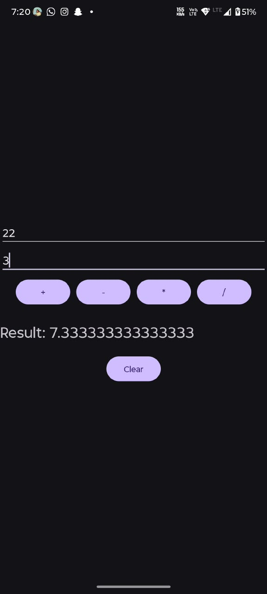

# Simple Calculator
## Project Overview
A simple Android calculator app developed using Kotlin and XML for the Veda Technology Android Development Track (Day 6). It performs basic arithmetic operations: addition, subtraction, multiplication, and division.
## Technologies Used
- Kotlin
- XML Layouts
- Android Studio
## Features
- Two input fields for numbers
- Buttons for +, -, *, /
- Displays result dynamically
- Handles division by zero gracefully
## How to Run
1. Clone the repository. 2. Open in Android Studio. 3. Sync Gradle. 4. Run the app.
## Outcome
The application successfully performs all four arithmetic operations and handles edge cases like division by zero.
## Screenshot

